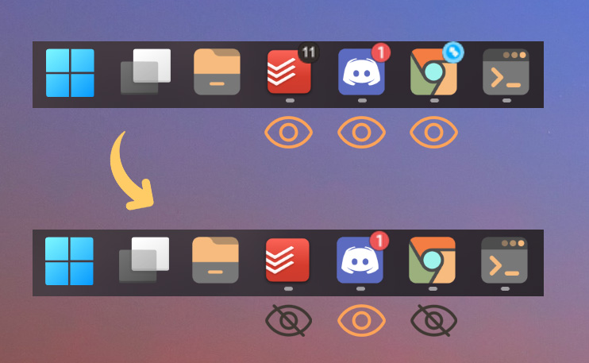
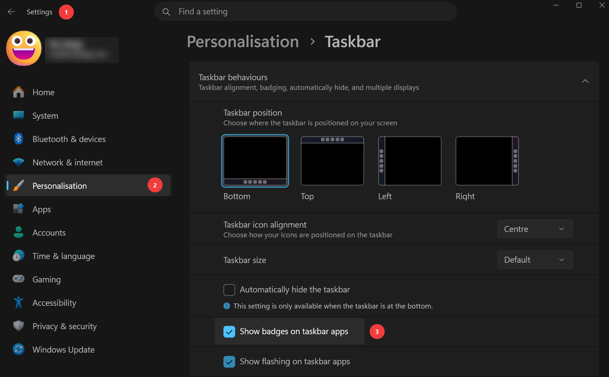

<p align="center">
  
  <br/>
</p>
<h3 align="center">Taskbar Badge Control</h3>
<p align="center">Show or hide taskbar badges per application (Windows 11).</p>
<h2></h2>
<br/>

<p align="center">
  <a href="../../actions/workflows/build.yml"></a>
  <a href="../../issues"></a>
  <a href="../../pulls"></a>
  <a href="LICENSE"></a>
</p>

## Description

This [Windhawk](https://windhawk.net/) mod lets you show or hide taskbar badges per
application, instead of turning them all on or off through Windows. It's useful
for apps that don't offer their own setting to disable taskbar badges.



Existing badges update when the mod is enabled, without hovering or clicking the
taskbar. Disabling the mod restores Windows-controlled badge appearance.

## Requirements

- Windows 11 x64 with the native taskbar. Windows 10, ARM64, and replacement
  taskbars are not supported.
- [Windhawk](https://windhawk.net/). Builds are checked with Windhawk 1.7.3.
- **Show badges on taskbar apps** enabled under **Settings → Personalization →
  Taskbar → Taskbar behaviors**.

If the Windows setting is disabled, all taskbar badges stay hidden regardless of
the mod's rules. Windhawk may need to download Windows symbols on first load.



## Instructions

To install the mod from source:

1. Download or copy [`taskbar-badge-control.wh.cpp`](taskbar-badge-control.wh.cpp).
2. Open Windhawk and choose **Create a new mod**.
3. Replace the template with the complete source file and select **Compile Mod**.
4. Enable the mod and configure its application list.

The compiled DLL is not a standalone application. Install the source through
Windhawk rather than loading the DLL manually.

## Configuration

Use the filtering mode to **show badges by default** or **hide badges by default**,
then populate **Applications** with the apps that should behave differently. The
list is empty by default.

Entries are case-insensitive exact matches against process names, full executable
paths, or AppUserModelIDs. For example:

```text
process.exe
C:\Apps\Example\process.exe
Microsoft.WindowsCalculator_8wekyb3d8bbwe!App
```

Wildcards and environment-variable expansion are not supported. An executable
rule applies to all matching taskbar groups; any matching process in a
mixed-process group matches that group.

An AppUserModelID rule can identify a background app with no windows from which
to resolve its executable path. An unresolved application identity is left
unchanged. Both desktop overlays and Windows-managed badges are filtered.

## Troubleshooting

- If allowed applications still have no badges, check the Windows badge setting
  shown above.
- Pictures or counts drawn directly into an application's base icon cannot be
  removed. Base icons, progress indicators, flashing, notifications, and tray
  icons are not changed.
- Styling mods which also change badge opacity may conflict with this mod.
- Private shell interfaces can change in Windows updates. An unsupported native
  layout prevents initialization rather than using a guessed offset.

Use Windhawk's built-in logging when reporting a problem. Include your Windows
build, filtering mode, monitor setup, and other enabled taskbar mods in an
[issue](../../issues). Review logs for personal paths before posting them.

## Development

The mod is a single self-contained source file at the repository root. To build
and run the standalone checks with a local Windhawk installation:

```powershell
powershell -NoProfile -ExecutionPolicy Bypass -File .\build.ps1 -Test
```

For a non-default installation, pass `-WindhawkDirectory "D:\Tools\Windhawk"`.
Output goes to the ignored `build/` directory. This does not enable the mod or
inject it into Explorer.

The [Build workflow](../../actions/workflows/build.yml) runs on pushes to `main`,
pull requests, and manual dispatch. It uses a pinned, checksum-verified Windhawk
1.7.3 portable toolchain to compile the mod and run the checks. It does not install
the mod in Explorer or test taskbar rendering. After its first successful run,
the **Build and test (Windows x64)** check can be required by branch protection.

See [`TESTING.md`](TESTING.md) for runtime regression checks. Basic filtering and
immediate enable/disable behavior have been tested on Windows 11 build
**26300.9974**; broader lifecycle coverage still requires manual testing.

The mod uses targeted events and cached executable identities, with no recurring
full-tree scan. Loading taskbars can receive up to eight short retries. No
numerical CPU or latency claim has been established by profiling.

For the official Windhawk catalog, submit only
`mods/taskbar-badge-control.wh.cpp` to
[`ramensoftware/windhawk-mods`](https://github.com/ramensoftware/windhawk-mods).
This development repository's assets, tests, and build files are separate from
that single-file submission.

## Contributions

Contributions are welcome. Open an [issue](../../issues) to discuss a change, or
make a [pull request](../../pulls). Run the build/checks and describe any taskbar
behavior you tested.

## Credits

The shell interface declarations and parts of the native taskbar integration
were adapted from or informed by m417z's GPL-3.0 Windhawk mods:

- [Taskbar Labels](https://github.com/ramensoftware/windhawk-mods/blob/main/mods/taskbar-labels.wh.cpp)
- [Taskbar Height and Icon Size](https://github.com/ramensoftware/windhawk-mods/blob/main/mods/taskbar-icon-size.wh.cpp)
- [Start Button Position](https://github.com/ramensoftware/windhawk-mods/blob/main/mods/taskbar-start-button-position.wh.cpp)
- [Taskbar Reorder by Right Drag](https://github.com/ramensoftware/windhawk-mods/blob/main/mods/taskbar-reorder-right-drag.wh.cpp)


## Licence

[GNU General Public License v3.0 only](LICENSE).
